<!-- SIGNAL / EVIDENCE · GitHub profile, Markdown and GitHub-safe HTML -->

  <picture>
    <source media="(prefers-reduced-motion: reduce)" srcset="./assets/profile-banner.svg" />
    
  </picture>

  <h3>Penetration Testing · Web &amp; API Security · Systems &amp; Automation</h3>
  
I investigate how systems behave, validate security weaknesses, and build tools that make technical work reproducible.

  

    
    
    
  

  

    
    
    
  

---

## 01 / About

I'm a cybersecurity practitioner and Electronics & Communications Engineer with **professional penetration-testing experience** and a background in **enterprise technical solutions**. My work combines authorized security assessment, HTTP/API troubleshooting, Linux and Windows systems, and practical automation.

I focus on the step between *finding something interesting* and *proving it matters*: defining scope, testing assumptions, ruling out false positives, reproducing behavior, and writing documentation another engineer can follow.

> **Security without evidence is a hypothesis. Engineering turns it into something testable.**

## 02 / Featured security work

<table>
  <tr>
    <td width="50%" valign="top">
      <h3><a href="https://github.com/M0stafaAhmed/0xFieldbook">0xFieldbook — Offensive Security Fieldbook</a></h3>
      
An Astro-powered, sanitized collection of authorized training walkthroughs, attack-path explanations, methodologies, and reusable technical notes.

      <ul>
        <li>Static pages generated from structured Markdown with Pagefind search.</li>
        <li>Source-level redaction and publication checks for sensitive flags and endpoints.</li>
        <li>Reproducible technical narratives with evidence and documented limitations.</li>
      </ul>
      
Astro · TypeScript · Markdown · Pagefind · Security Documentation

    </td>
    <td width="50%" valign="top">
      <h3><a href="https://github.com/M0stafaAhmed/PAWN-Commands-sheet-cheat">PwnRef — Pentesting Command Reference</a></h3>
      
A fast browser-based reference for penetration-testing commands and practical workflows.

      <ul>
        <li>34 categories and 141 command cards.</li>
        <li>Search, copy controls, and local-browser favorites.</li>
        <li>Static reference only: no command execution or target scanning.</li>
      </ul>
      
HTML · CSS · JavaScript · Reconnaissance · Security Workflows

    </td>
  </tr>
</table>

## 03 / Engineering projects

<table>
  <tr>
    <td width="50%" valign="top">
      <h3><a href="https://github.com/M0stafaAhmed/LogSpire">LogSpire — Desktop Log Analyzer</a></h3>
      
A Windows desktop application for reviewing dated application logs, extracting error events with surrounding context, filtering findings, and investigating full log files through a searchable viewer.

      <ul>
        <li>PyQt5 interface with an integrated English/Arabic on-screen keyboard.</li>
        <li>Cython-based parser and contextual event extraction.</li>
        <li>Syntax highlighting, regular-expression search, and export support.</li>
        <li>Windows build and parser-test workflow.</li>
      </ul>
      
Python · PyQt5 · Cython · PyInstaller

      
    </td>
    <td width="50%" valign="top">
      <h3><a href="https://github.com/M0stafaAhmed/PDF-Image-Extractor">PDF Image Extractor</a></h3>
      
A Windows desktop utility for extracting original embedded image data from PDF documents.

      <ul>
        <li>PyMuPDF extraction, not page screenshots.</li>
        <li>Tkinter desktop UI and portable Windows build configuration.</li>
        <li>Regression tests for embedded images and empty documents.</li>
      </ul>
      
Python · Tkinter · PyMuPDF · PyInstaller

      
    </td>
  </tr>
  <tr>
    <td width="50%" valign="top">
      <h3><a href="https://github.com/M0stafaAhmed/zsh-academy_final">Zsh Mastery Academy</a></h3>
      
An interactive seven-level learning platform spanning CLI fundamentals, scripting, Zsh engineering, and pentesting automation.

      
Zsh · JavaScript · Interactive Education

    </td>
    <td width="50%" valign="top">
      <h3><a href="https://github.com/M0stafaAhmed/Linux-from-Basics-Professional-">Linux Administration Reference</a></h3>
      
A task-oriented reference for permissions, processes, services, networking, storage, troubleshooting, and secure administration.

      
Linux · System Administration · Technical Documentation

    </td>
  </tr>
</table>

## 04 / Technical focus

**Security assessment**

  
  
  
  
  
  

**Networking & systems**

  
  
  
  
  

**Scripting & engineering**

  
  
  
  
  
  

Tools and techniques are drawn from professional experience, project code, and authorized training—not a claim of equal mastery or vendor certification.

## 05 / Professional background

- **Penetration Tester (Part-Time) · Orchida-Tax · May–Oct 2026** — authorized assessment activities, controlled vulnerability validation, technical findings, and remediation-oriented reporting.
- **Technical Solution Engineer · Orchida-Tax · Sep 2024–Oct 2026** — enterprise applications, e-invoicing/REST integrations, HTTP/JSON troubleshooting, Windows services, and functional testing.
- **Penetration Testing Intern · IT Gate Academy · training started Oct 2025** — structured lab work on web vulnerabilities, service enumeration, misconfigurations, and Linux privilege escalation.

**Education:** B.Eng. in Electronics & Communications Engineering (2023).

## 06 / How I approach security work

**SCOPE &nbsp;→&nbsp; DISCOVER &nbsp;→&nbsp; VALIDATE &nbsp;→&nbsp; DEMONSTRATE &nbsp;→&nbsp; DOCUMENT**

Authorized scope · Repeatable steps · Explicit evidence · Honest limitations

I document failed hypotheses and prerequisites along with successful reproduction steps, because a useful report must be verifiable by someone other than its author.

## 07 / Connect

  
  

<strong>BUILD WITH INTENT · TEST WITH EVIDENCE · DOCUMENT WHAT MATTERS</strong>

## 08 / GitHub analytics

Dynamic cards use public GitHub information and third-party services; figures can be cached or incomplete. Repository language distribution is not a measure of professional proficiency.

---

<strong>License & permission policy</strong>

The original material in this repository is proprietary and all rights are reserved. Viewing and forking a public repository on GitHub remain subject to GitHub's Terms of Service. Those platform permissions do not grant general permission to reuse, modify, redistribute, sublicense, or commercially exploit my original work outside the rights GitHub provides.

**Obtain prior, express, written permission before reusing my original work beyond those platform permissions.** A request is not approval; wait for written authorization. See [LICENSE](./LICENSE) for the full policy, third-party exclusions, and treatment of earlier license grants.

Third-party libraries, fonts, images, trademarks, standards, curricula, and other external material remain subject to their respective owners' licenses and terms. This repository does not relicense them.

