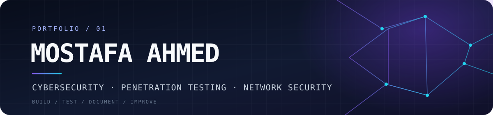

  

  

    <strong>CYBERSECURITY ENGINEERING · OFFENSIVE SECURITY · SYSTEMS & AUTOMATION</strong>
  

  

    I investigate systems, build practical tooling, and turn technical work into repeatable documentation.
  

  

    
    
    
  

  

    
    
    
  

---

## 01 / Profile

I'm an electrical and communications engineering graduate working toward a career in **penetration testing and cybersecurity**. My technical work spans security labs, Linux and Windows environments, network troubleshooting, scripting, and browser-based engineering tools.

I prefer work that can be inspected and reproduced: clear scope, useful evidence, validated results, and documentation that explains both the successful path and the mistakes.

| **Technical direction** | **How I approach the work** |
|:--|:--|
| Offensive security, Linux administration, network security, and automation | **Scope → Enumerate → Validate → Document → Improve** |
| Python, Bash/Zsh, PowerShell, and practical web tooling | Build small, usable tools instead of collecting disconnected notes |

**Career direction:** Junior Penetration Tester / Cybersecurity Engineer. Open to relevant opportunities in Egypt and relocation.

## 02 / Engineering Focus

<table>
  <tr>
    <td width="50%" valign="top">
      <h3>⌁ Offensive Security</h3>
      
Reconnaissance, service enumeration, web-testing workflows, exploitation fundamentals, privilege-escalation research, and evidence-driven lab documentation.

      Authorized labs · Reusable PoCs · Command references
    </td>
    <td width="50%" valign="top">
      <h3>⌘ Linux & Systems</h3>
      
Linux administration, permissions, services, networking, logs, troubleshooting, shell engineering, and Windows Server fundamentals.

      Kali Linux · Zsh · Bash · Vim · Windows Server
    </td>
  </tr>
  <tr>
    <td width="50%" valign="top">
      <h3>⚙ Automation & Tooling</h3>
      
Python utilities, shell scripts, PowerShell workflows, log analysis, and small tools that reduce repetitive technical work.

      Python · Bash · PowerShell · JavaScript
    </td>
    <td width="50%" valign="top">
      <h3>▤ Technical Learning Systems</h3>
      
Structured study references, interactive quizzes, searchable command catalogs, and documentation designed for practical use.

      Static web apps · Markdown · Obsidian · Firebase Hosting
    </td>
  </tr>
</table>

## 03 / Selected Public Work

<table>
  <tr>
    <td width="34%" valign="top">
      <strong><a href="https://mostafa-ahmed-1970f.web.app/">Personal Portfolio</a></strong>
      
Professional profile, experience, technical focus, and selected engineering work.

      HTML · CSS · JavaScript
    </td>
    <td width="33%" valign="top">
      <strong><a href="https://github.com/M0stafaAhmed/Docs">Linux & Systems References</a></strong>
      
Browser-based Vim cheat sheet and an interactive sudoers rule explorer.

      HTML · CSS · JavaScript
    </td>
    <td width="33%" valign="top">
      <strong><a href="https://github.com/M0stafaAhmed/ISTQB-Roadmap">ISTQB Study Roadmap</a></strong>
      
Foundation Level study guide, 80 chapter-practice questions, and a separate 100-question final practice exam.

      HTML · CSS · JavaScript
    </td>
  </tr>
</table>

## 04 / Private Engineering Workbench

A selection of projects currently maintained in private repositories. They are kept separate from the public portfolio while their content and documentation continue to evolve.

| Project | What it contains |
|:--|:--|
| **PwnRef** | A browser-based penetration-testing reference with 34 sections and 141 searchable command cards. |
| **CEH Study Reference** | An independent study tracker organized into 11 modules and 54 topics, with browser-local progress and backup/export. |
| **Zsh Mastery Academy** | A seven-level interactive learning platform covering shell fundamentals through advanced Zsh and automation, with quizzes and local progress tracking. |
| **Linux Administration Reference** | A task-oriented Linux reference covering administration, troubleshooting, networking, storage, services, and security-testing specializations. |
| **Vim Cheat Sheet** | A consolidated browser reference for navigation, editing, registers, buffers, windows, search, substitution, and macros. |
| **Lab PoC Knowledge Base** | Private machine-level lab records and reusable proof-of-concept notes, with an emphasis on commands, evidence, validation status, and lessons learned. |

## 05 / Technology & Tools

  
  
  
  
  
  
  
  
  
  
  
  

## 06 / GitHub Activity

  
  

---

  <strong>BUILD WITH INTENT · TEST WITH EVIDENCE · DOCUMENT WHAT MATTERS</strong>
   
  Based in Egypt · Open to cybersecurity opportunities

