  

  
<strong>CYBERSECURITY ENGINEERING · OFFENSIVE SECURITY · SYSTEMS & AUTOMATION</strong>

  
I investigate systems, build practical tooling, and turn technical work into repeatable documentation.

  

    
    
    
    
  

  

    
    
    
  

---

## 01 / Profile

I'm an electrical and communications engineering graduate working toward a career in **penetration testing and cybersecurity**. My technical work spans authorized security labs, Linux and Windows environments, network troubleshooting, scripting, and browser-based engineering tools.

I prefer work that can be inspected and reproduced: clear scope, useful evidence, validated results, and documentation that explains both the successful path and the mistakes.

| **Technical direction** | **How I approach the work** |
|:--|:--|
| Offensive security, Linux administration, network security, and automation | **Scope → Enumerate → Validate → Document → Improve** |
| Python, Bash/Zsh, PowerShell, and practical web tooling | Build small, usable tools instead of collecting disconnected notes |

**Career direction:** Junior Penetration Tester / Cybersecurity Engineer. Open to relevant opportunities in Egypt and relocation.

## 02 / Engineering Focus

<table>
  <tr>
    <td width="50%" valign="top">
      <h3>⌁ Offensive Security</h3>
      
Reconnaissance, service enumeration, web-testing workflows, exploitation fundamentals, privilege-escalation research, and evidence-driven lab documentation.

      Authorized labs · Reusable PoCs · Command references
    </td>
    <td width="50%" valign="top">
      <h3>⌘ Linux & Systems</h3>
      
Linux administration, permissions, services, networking, logs, troubleshooting, shell engineering, and Windows Server fundamentals.

      Kali Linux · Zsh · Bash · Vim · Windows Server
    </td>
  </tr>
  <tr>
    <td width="50%" valign="top">
      <h3>⚙ Automation & Tooling</h3>
      
Python utilities, shell scripts, PowerShell workflows, log analysis, and small tools that reduce repetitive technical work.

      Python · Bash · PowerShell · JavaScript
    </td>
    <td width="50%" valign="top">
      <h3>▤ Technical Learning Systems</h3>
      
Structured study references, interactive quizzes, searchable command catalogs, and documentation designed for practical use.

      Static web apps · Markdown · Obsidian · Firebase Hosting
    </td>
  </tr>
</table>

## 03 / Selected Public Work

<table>
  <tr>
    <td width="50%" valign="top">
      <h3><a href="https://github.com/M0stafaAhmed/PAWN-Commands-sheet-cheat">PwnRef — Pentesting Command Reference</a></h3>
      
A searchable browser-based reference with 34 sections and 141 command cards. It documents workflows; it does not execute commands.

      HTML · CSS · JavaScript · Offensive Security
    </td>
    <td width="50%" valign="top">
      <h3><a href="https://github.com/M0stafaAhmed/zsh-academy_final">Zsh Mastery Academy</a></h3>
      
A seven-level interactive learning platform covering shell fundamentals, scripting, advanced Zsh, and automation, with quizzes and browser-local progress.

      Zsh · Shell Scripting · JavaScript
    </td>
  </tr>
  <tr>
    <td width="50%" valign="top">
      <h3><a href="https://github.com/M0stafaAhmed/Linux-from-Basics-Professional-">Linux Administration Reference</a></h3>
      
A task-oriented reference for administration, permissions, services, networking, storage, troubleshooting, and security-testing specializations.

      Linux · System Administration · Documentation
    </td>
    <td width="50%" valign="top">
      <h3><a href="https://github.com/M0stafaAhmed/CEH-Study-Reference">CEH v13 Study Reference</a> · In progress</h3>
      
An independent browser-based study tracker. Modules 01–11 are represented with 54 partial topic labels; Modules 12–20 are pending. The 55% figure counts module headings, not syllabus completion.

      HTML · CSS · JavaScript · Local Progress Tracking
    </td>
  </tr>
  <tr>
    <td width="50%" valign="top">
      <h3><a href="https://github.com/M0stafaAhmed/portfolio">Personal Portfolio — Source</a></h3>
      
Professional profile, experience, selected projects, and technical focus. The repository has been refreshed; the Firebase-hosted website still needs its deployment update.

      HTML · CSS · JavaScript · Firebase Hosting
    </td>
    <td width="50%" valign="top">
      <h3><a href="https://github.com/M0stafaAhmed/Docs">Engineering Documentation</a></h3>
      
Browser-based technical references, including a Vim cheat sheet and an interactive sudoers rule explorer.

      Linux · Vim · Sudoers · Web Tools
    </td>
  </tr>
  <tr>
    <td width="50%" valign="top">
      <h3><a href="https://github.com/M0stafaAhmed/ISTQB-Roadmap">ISTQB Foundation Study Roadmap</a></h3>
      
A structured Foundation Level study guide with chapter practice and a separate final practice exam.

      Study Systems · HTML · CSS · JavaScript
    </td>
    <td width="50%" valign="top">
      <h3><a href="https://github.com/M0stafaAhmed">More on GitHub</a></h3>
      
Browse the public repositories for additional references, experiments, and engineering work.

      Public repositories · Source code · Documentation
    </td>
  </tr>
</table>

## 04 / Current Development

  
<strong>Open current work and technical experiments</strong>

   

  | Workstream | Current scope |
  |:--|:--|
  | **Kali Tool Session Logging** | Building a portable workflow for per-tool and per-session output, organized by tool, date, and session while remaining traceable alongside shell history. |
  | **OSCP Exam PoC Knowledge Base** | Maintaining structured machine notes and reusable proof-of-concept records with commands, evidence, validation status, and lessons learned. |
  | **System & Security Log Analyzer** | Developing a Python/PyQt5 desktop utility for reviewing multiple log sources and investigating errors and anomalies. |

  These workstreams are under active development and are not presented as finished public releases.

## 05 / Technology & Tools

  
  
  
  
  
  
  
  
  
  
  
  

## 06 / Connect

  
  

---

  <strong>BUILD WITH INTENT · TEST WITH EVIDENCE · DOCUMENT WHAT MATTERS</strong>
   
  Based in Egypt · Open to cybersecurity opportunities

